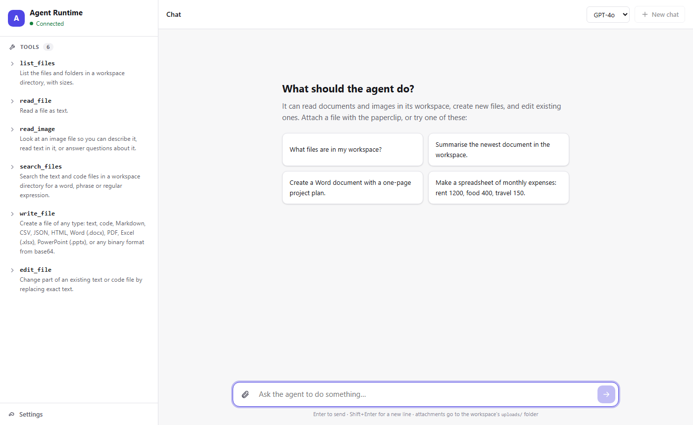
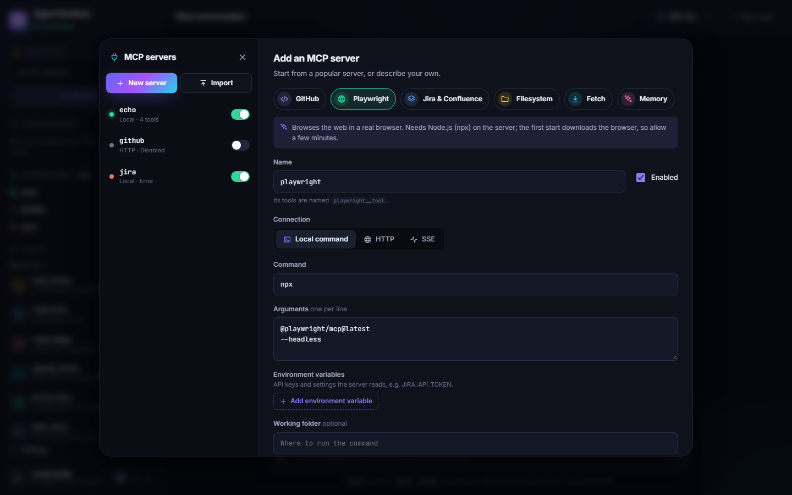
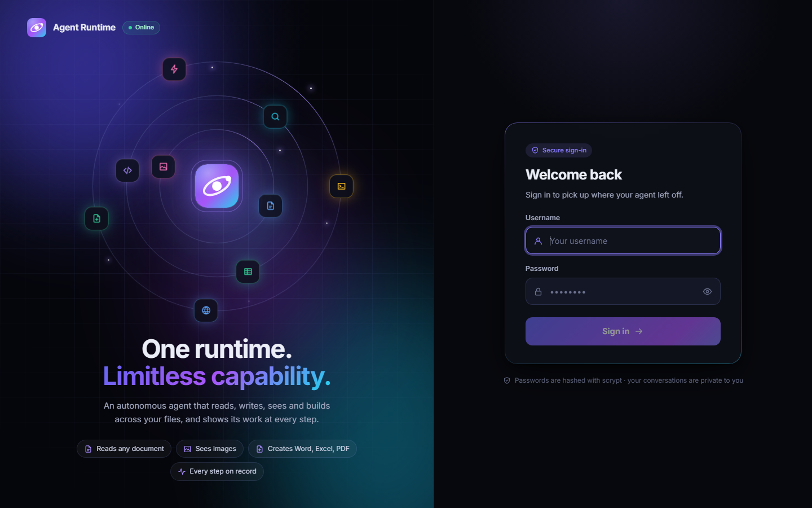

# Agent Runtime: Frontend

A React web app for the [agent-runtime backend](../agent-runtime-backend). People
sign in, pick the folder the agent works in, and chat with it: the reply
streams in token by token, and every tool call appears inline as it runs.
Past conversations are saved and can be reopened exactly as they were.



> Not a developer? The **[User Guide](USER_GUIDE.md)** explains how to start and
> use the web app in plain language.

What it does:

- **Sign-in page.** An animated hero (the runtime at the centre, its
  capabilities in orbit) and a sign-in card. On a brand-new server the card
  creates the first (admin) account instead. Shown only when the backend has
  sign-in enabled (it has a database); otherwise the app opens directly in
  "Local mode".
- **Live streaming** over `POST /v1/chat/stream`. Each tool call is a card
  with its own icon and colour, a readable name, status, arguments, result and
  duration. A status line says what the agent is doing ("Thinking…",
  "Using read file…").
- **Saved conversations** (`/v1/sessions`), listed in the sidebar to reopen,
  rename or delete. A reopened conversation is rebuilt by replaying its
  recorded events through the same reducer that rendered it live.
- **MCP integrations** (`/v1/mcp`). An **Integrations** section in the sidebar
  shows each MCP server's status and tool count. **Manage** opens the MCP
  servers dialog:
  - add from templates (GitHub, Playwright, Jira, Filesystem, Fetch, Memory)
    or from scratch: local command (stdio), HTTP or SSE, with arguments, env
    vars and headers
  - **test the connection** before saving, and see the tools it found
  - view, edit, enable or disable, reconnect, delete
  - import the `mcpServers` JSON from Claude Desktop, Cursor or VS Code

  Connected servers' tools join the tool list, grouped by server, and their
  calls show as `server · tool` cards. Saved secrets are never sent back to the
  browser. Non-admins can look but not change.

  

- **Workspace picker.** Browse the server's folders and choose where the agent
  works. The choice is remembered, and reopening a conversation returns to its
  folder.
- **File attachments**: picked files are uploaded to the workspace's
  `uploads/` folder and their paths are passed to the agent.
- **Downloads**: files the agent creates with `write_file` get a download
  button.
- **Model picker** from `GET /v1/models`, remembered per browser, with token
  usage and cost shown under each reply.
- **Themes**: dark, light, or follow the system, switchable in the sidebar.
- **Optional API key** (Settings, in Local mode), for servers started with
  `API_KEY`.
- **Responsive and accessible**: on narrow screens the sidebar becomes a
  drawer and the sign-in hero becomes a banner. It works fully from the
  keyboard, announces finished replies to screen readers, and respects
  reduced-motion settings.



## Quick start

Requires Node.js 20.19+ and a running backend (`agent-runtime serve`, by
default on port 8000).

```bash
npm install
npm run dev        # http://localhost:5173
```

In development, Vite proxies `/v1` and `/health` to the backend, so no CORS
setup is needed. To proxy to a backend somewhere else, set `VITE_PROXY_TARGET`
in `.env.local` (see [.env.example](.env.example)).

## Scripts

| Command                           | What it does                                                   |
| --------------------------------- | -------------------------------------------------------------- |
| `npm run dev`                     | Dev server with hot reload                                     |
| `npm run build`                   | Type-check and build to `dist/`                                |
| `npm run preview`                 | Serve the production build locally                             |
| `npm run check`                   | Everything CI should run: typecheck, lint, format check, tests |
| `npm test` / `npm run test:watch` | Vitest, once or in watch mode                                  |
| `npm run lint` / `npm run format` | ESLint / Prettier                                              |

## Deploying

**With Docker:** the [Dockerfile](Dockerfile) builds an unprivileged nginx
image that serves the app and proxies the API, already configured for
streaming. See the **[Docker guide](DOCKER.md)**.

**Without Docker:** `npm run build` produces static files in `dist/`. Serve
them however you like. There are two setups.

**Same origin (recommended).** Serve `dist/` and proxy the API paths to the
backend from one host. Leave `VITE_API_BASE_URL` empty. Example nginx config:

```nginx
server {
    listen 80;
    root /srv/agent-runtime-frontend/dist;

    location / {
        try_files $uri /index.html;
    }

    location ~ ^/(v1|health) {
        proxy_pass http://127.0.0.1:8000;
        # Stream chat events as they are produced, not when the reply ends.
        proxy_buffering off;
        proxy_read_timeout 300s;
        client_max_body_size 30m;   # Attachments; match MAX_FILE_BYTES.
    }
}
```

**Separate origins.** Build with `VITE_API_BASE_URL=https://api.example.com`
and add the UI's origin to the backend's `CORS_ALLOW_ORIGINS`.

Every `VITE_*` value is compiled into the JavaScript bundle and is visible to
anyone. Never put a secret there. The sign-in token, and the API key in Local
mode, stay in the user's browser (localStorage); the token is sent as
`Authorization: Bearer`. Use HTTPS whenever passwords or keys cross a network.

The fonts (Inter and JetBrains Mono) are bundled from npm, so the app makes no
third-party requests and works under the image's strict Content-Security-Policy.

## Project structure

```
src/
  api/
    types.ts          Wire types, mirroring the backend's schemas and events
    client.ts         Typed API client: errors, token and API key, sign-in,
                      sessions, folders, uploads, downloads, streaming
    sse.ts            Server-Sent Events parser for fetch streams (EventSource can't POST)
    ApiContext.tsx    Provides the client to components
  chat/
    chatReducer.ts    Pure reducer: stream events -> conversation turns
    history.ts        Rebuilds a stored conversation by replaying its events
    useChat.ts        Sends messages, streams runs, stop / new chat / load
    useAttachments.ts Uploads attached files into the workspace
  components/
    auth/             LoginPage (sign-in and first-run setup)
    mcp/              McpPanel (sidebar), McpDialog, McpServerForm, McpServerDetail,
                      McpImport, KeyValueEditor, useMcpServers (data and polling)
    brand/            Logo, OrbitVisual (login hero), Splash
    sidebar/          Sidebar, WorkspacePanel, DirectoryBrowser, SessionList,
                      ToolList, ToolItem, SettingsPanel
    chat/             ChatPanel, MessageList, Message, ToolCallCard, Composer, Markdown
    Icon.tsx          Inline SVG icons
  hooks/useResource.ts  Load-once data hook with cancellation and reload
  lib/                Formatting, storage, theme, tool icons, password strength,
                      MCP templates and status labels, schema and tool-call helpers
  styles/global.css   Design tokens (dark and light) and base styles
  Root.tsx            The client, credentials, and what to show: splash, sign-in, or the app
  App.tsx             The two-column shell and app-wide state
  test/               Test setup and a fake backend for integration tests
```

Design notes:

- **The API contract lives in one file.** `api/types.ts` mirrors the backend
  field for field. When the backend changes, update it, and the compiler
  points at everything that has to follow.
- **Conversation logic is a pure reducer.** Every rule about how events become
  what the user sees (token merging, pairing tool results with their calls,
  terminal states) is unit-tested without React, and the same reducer replays
  stored conversations.
- **Signing out unmounts the app.** `Root` owns the credentials and chooses
  between the splash, sign-in page and app, so no state from one account can
  leak into the next. A token the server rejects sends you back to sign in.
- **Model output is never rendered as HTML.** Markdown is rendered with
  `react-markdown`, which ignores raw HTML, and links open in a new tab
  without opener access.
- **No UI framework.** CSS Modules with design tokens in `global.css` (the
  brand gradient, tool tones, surfaces, shadows) for both themes, so there's
  no runtime styling cost and nothing to override. The theme is a
  `data-theme` attribute on `<html>`, applied before the first paint.

## Testing

`npm test` runs these tests, all offline:

- **The SSE parser**, including events split at every possible chunk boundary,
  CRLF split across chunks, and UTF-8 characters split across byte chunks.
- **The chat reducer**, and **history replay**: stored events rebuild the same
  turns, and unfinished runs are closed correctly.
- **The API client**: error mapping, auth headers, streaming, URL encoding.
- **Sign-in** against a fake backend (`src/test/fakeServer.ts`): first-run
  setup, wrong passwords, signing out, an expired token, an unreachable
  server, and servers without sign-in.
- **MCP management** (`src/Mcp.test.tsx`): adding from a template after a
  test, form checks, disabling, editing env vars, deleting, importing JSON,
  read-only access for non-admins, and new tools reaching the tool list.
- **Integration tests of the whole app**: tools in the sidebar, streaming
  replies with tool cards and downloads, sessions, stop, attachments, choosing
  a folder, reopening and deleting conversations, errors and the offline state.
